[🇬🇧 English](README.md) · [🇧🇷 Português](README.pt-BR.md) · **🇪🇸 Español**

# Natanael Lima

### Pentester · Red Team · Seguridad Ofensiva · OSINT

Profesional de ciberseguridad en Portugal 🇵🇹 — hacking ético, análisis de vulnerabilidades, reconocimiento y automatización de seguridad con Python.

 

---

## 🛠️ Proyectos destacados

<table>
<tr>
<td width="50%" valign="top">

### 🔍 [Google Dork Scanner v3](https://github.com/ademakin3051/ferramentagoogledorks)
**Herramienta de OSINT y reconocimiento** con Google Dorks (Google Hacking). Base de dorks por categoría, varios modos de escaneo e integración con API para mapear la **superficie de ataque** de una organización y encontrar archivos, paneles de administración e información expuesta — creada para evaluaciones de seguridad autorizadas.

`Python` `OSINT` `Reconocimiento` `Superficie de Ataque`

</td>
<td width="50%" valign="top">

### 🤖 [Bot de Service Desk GLPI (IA + WhatsApp)](https://github.com/ademakin3051/botglpi)
**Automatización ITSM** que abre y da seguimiento a tickets de GLPI por WhatsApp, resume el historial del ticket con GPT y escala a un agente humano cuando hace falta. Construido con workflows de n8n, APIs REST y webhooks.

`n8n` `GLPI` `ITSM` `OpenAI` `WhatsApp API`

</td>
</tr>
<tr>
<td width="50%" valign="top">

### 🌐 [natanaellima.blog](https://github.com/ademakin3051/portifolio)
Portafolio personal y **blog de ciberseguridad** — case studies, proyectos y artículos. HTML, CSS y JavaScript escritos a mano, sin frameworks.

`HTML` `CSS` `JavaScript`

</td>
<td width="50%" valign="top">

### ⌨️ [Digitador Automático](https://github.com/ademakin3051/digitador-automatico)
**Automatización de escritorio** en Python que simula escritura humana en cualquier editor. Interfaz en Tkinter con control de teclado vía pynput.

`Python` `Tkinter` `pynput`

</td>
</tr>
</table>

---

## 👨‍💻 Sobre mí

Soy **Natanael Lima**, profesional de TI y ciberseguridad enfocado en **seguridad ofensiva**: pruebas de penetración (pentest), técnicas de red team, reconocimiento, OSINT e ingeniería social.

Tengo **más de 5 años de experiencia práctica en TI** — hardware, redes y soporte N1/N2 en empresas como **Grupo Positivo** — lo que me da una visión real de cómo se construyen los entornos corporativos y dónde fallan. Hoy combino seguridad y **automatización**: Python, n8n y chatbots con IA que eliminan trabajo manual en soporte y operaciones.

Actualmente cursando la **carrera de Ciberseguridad** (Uninter).

## 🎯 Disponible para

- **Puestos:** Pentester Junior · Analista Red Team · Analista de Ciberseguridad · Service Desk / Soporte TI · Automatización de Procesos y Seguridad
- **Ubicación:** Portugal (Setúbal / área de Lisboa) · presencial, híbrido o remoto
- **Idiomas:** Portugués (nativo) · Español (B2) · Inglés (en progreso)

---

## 🧰 Competencias

- **Seguridad Ofensiva:** Pentest · Red Team · Hacking Ético · Análisis de Vulnerabilidades · Reconocimiento · OSINT · Google Dorking · Ingeniería Social · Seguridad WordPress
- **Herramientas:** Kali Linux · Metasploit · Nmap · Wireshark · WPScan
- **Redes y Sistemas:** Configuración de redes · Dominio Windows (Active Directory) · FortiClient VPN · Linux · Windows · macOS
- **Automatización e IA:** Python · Selenium · RPA · n8n · Zapier · Make (Integromat) · APIs REST · Webhooks · OpenAI API · Chatbots
- **Operaciones TI:** Service Desk N1/N2 · ITSM (GLPI) · Inventario de activos · Imagen corporativa · Mantenimiento de hardware

 

**Ofensivo** &nbsp;      

**Automatización & IA** &nbsp;      

**Infra & Soporte** &nbsp;      

---

## 📡 Recon sobre mí

---

## 📬 Hablemos

Reclutadores y equipos de seguridad: la forma más rápida de contactarme es por **[LinkedIn](https://www.linkedin.com/in/natanaellima10/)** o **[natanaellima65@gmail.com](mailto:natanaellima65@gmail.com)**.

