**🇬🇧 English** · [🇧🇷 Português](README.pt-BR.md) · [🇪🇸 Español](README.es.md)

# Natanael Lima

### Penetration Tester · Red Team · Offensive Security · OSINT

Cybersecurity professional based in Portugal 🇵🇹 — ethical hacking, vulnerability assessment, reconnaissance and security automation with Python.

 

---

## 🛠️ Featured projects &nbsp;`ls ~/projects`

<table>
<tr>
<td width="50%" valign="top">

### 🔍 [Google Dork Scanner v3](https://github.com/ademakin3051/ferramentagoogledorks)
**OSINT & reconnaissance tool** for Google Dorking (Google Hacking). Categorized dork database, multiple scan modes and API integration to map an organization's **attack surface** and find exposed files, admin panels and information disclosure — built for authorized security assessments.

`Python` `OSINT` `Reconnaissance` `Attack Surface`

</td>
<td width="50%" valign="top">

### 🤖 [GLPI Service Desk Bot (AI + WhatsApp)](https://github.com/ademakin3051/botglpi)
**ITSM automation** that opens and tracks GLPI tickets over WhatsApp, summarizes ticket history with GPT and escalates to a human when needed. Built with n8n workflows, REST APIs and webhooks.

`n8n` `GLPI` `ITSM` `OpenAI` `WhatsApp API`

</td>
</tr>
<tr>
<td width="50%" valign="top">

### 🌐 [natanaellima.blog](https://github.com/ademakin3051/portifolio)
Personal portfolio and **cybersecurity blog** — case studies, projects and articles. Hand-written HTML, CSS and JavaScript, no frameworks.

`HTML` `CSS` `JavaScript`

</td>
<td width="50%" valign="top">

### ⌨️ [Auto Typer](https://github.com/ademakin3051/digitador-automatico)
**Desktop automation** in Python that simulates human typing in any editor. Tkinter GUI with keyboard control via pynput.

`Python` `Tkinter` `pynput`

</td>
</tr>
</table>

---

## 👨‍💻 About me &nbsp;`whoami`

I'm **Natanael Lima**, a **pentester and red team enthusiast**. My job is to think like an attacker — map the attack surface, find the weak spot and prove the impact — so companies fix it before someone else finds it. My focus: **penetration testing, red team techniques, reconnaissance, OSINT and social engineering**, always within an **authorized scope**.

I bring **5+ years of hands-on IT experience** — hardware, networking and L1/L2 service desk at companies like **Grupo Positivo** — which gives me a practical view of how corporate environments are built and where they break. Today I combine security with **automation**: Python, n8n and AI-powered chatbots that remove manual work from support and operations.

**Degree in Cybersecurity** — Uninter (2023).

## 🎯 Open to &nbsp;`cat target.txt`

- **Roles:** Junior Penetration Tester · Red Team Analyst · Cybersecurity Analyst · IT Service Desk / IT Support · Security & Process Automation
- **Location:** Portugal (Setúbal / Lisbon area) · on-site, hybrid or remote
- **Languages:** Portuguese (native) · Spanish (professional working) · English (limited working proficiency, improving)

---

## ⚔️ Attack chain &nbsp;`./engage.sh --scope authorized`

How I approach a penetration test, from first contact to final report:

| Phase | What I do | Tools |
|---|---|---|
| `01` Recon | OSINT, Google Dorking and attack surface mapping | OSINT · Google Dorks · Nmap |
| `02` Enumeration | Hosts, open ports, services, versions and CMS fingerprinting | Nmap · WPScan |
| `03` Analysis | Web request interception and network traffic analysis | Burp Suite · Wireshark |
| `04` Exploitation | Validating vulnerabilities and proving real impact in authorized environments | Metasploit · Kali Linux |
| `05` Reporting | Clear findings, risk and remediation steps the team can act on | Markdown · Python |
| `06` Automation | Turning repetitive steps into my own scripts and tools | Python |

> 🔐 **Rules of engagement first.** No scope, no scan.

---

## 🧰 Core skills &nbsp;`which arsenal`

- **Offensive Security:** Penetration Testing · Red Teaming · Ethical Hacking · Vulnerability Assessment · Reconnaissance · OSINT · Google Dorking · Social Engineering · WordPress Security
- **Security Tools:** Kali Linux · Metasploit · Nmap · Wireshark · WPScan · Burp Suite
- **Networks & Systems:** Network configuration · Windows domain (Active Directory join) · FortiClient VPN · Linux · Windows · macOS
- **Automation & AI:** Python · Selenium · RPA · n8n · Zapier · Make (Integromat) · REST APIs · Webhooks · OpenAI API · Chatbots
- **IT Operations:** Service Desk L1/L2 · ITSM (GLPI) · Asset inventory · Corporate imaging · Hardware maintenance

 

**Offensive** &nbsp;      

**Automation & AI** &nbsp;      

**Infra & Support** &nbsp;      

---

## 📡 Recon on myself &nbsp;`nmap -sV natanael`

---

## 📬 Let's talk &nbsp;`nc -lvnp 443`

Recruiters and security teams: the fastest way to reach me is **[LinkedIn](https://www.linkedin.com/in/natanaellima10/)** or **[natanaellima65@gmail.com](mailto:natanaellima65@gmail.com)**.

