[🇬🇧 English](README.md) · **🇧🇷 Português** · [🇪🇸 Español](README.es.md)

# Natanael Lima

### Pentester · Red Team · Segurança Ofensiva · OSINT

Profissional de cibersegurança em Portugal 🇵🇹 — hacking ético, análise de vulnerabilidades, reconhecimento e automação de segurança com Python.

 

---

## 🛠️ Projetos em destaque

<table>
<tr>
<td width="50%" valign="top">

### 🔍 [Google Dork Scanner v3](https://github.com/ademakin3051/ferramentagoogledorks)
**Ferramenta de OSINT e reconhecimento** com Google Dorks (Google Hacking). Base de dorks por categoria, vários modos de varredura e integração com API para mapear a **superfície de ataque** de uma organização e encontrar arquivos, painéis administrativos e informações expostas — feita para avaliações de segurança autorizadas.

`Python` `OSINT` `Reconhecimento` `Superfície de Ataque`

</td>
<td width="50%" valign="top">

### 🤖 [Bot de Service Desk GLPI (IA + WhatsApp)](https://github.com/ademakin3051/botglpi)
**Automação de ITSM** que abre e acompanha chamados no GLPI pelo WhatsApp, resume o histórico do chamado com GPT e escala para um atendente humano quando necessário. Feito com workflows n8n, APIs REST e webhooks.

`n8n` `GLPI` `ITSM` `OpenAI` `WhatsApp API`

</td>
</tr>
<tr>
<td width="50%" valign="top">

### 🌐 [natanaellima.blog](https://github.com/ademakin3051/portifolio)
Portfólio pessoal e **blog de cibersegurança** — case studies, projetos e artigos. HTML, CSS e JavaScript escritos à mão, sem frameworks.

`HTML` `CSS` `JavaScript`

</td>
<td width="50%" valign="top">

### ⌨️ [Digitador Automático](https://github.com/ademakin3051/digitador-automatico)
**Automação desktop** em Python que simula digitação humana em qualquer editor. Interface em Tkinter com controle de teclado via pynput.

`Python` `Tkinter` `pynput`

</td>
</tr>
</table>

---

## 👨‍💻 Sobre mim

Sou **Natanael Lima**, profissional de TI e cibersegurança com foco em **segurança ofensiva**: testes de intrusão (pentest), técnicas de red team, reconhecimento, OSINT e engenharia social.

Tenho **mais de 5 anos de experiência prática em TI** — hardware, redes e suporte N1/N2 em empresas como o **Grupo Positivo** — o que me dá uma visão real de como ambientes corporativos são montados e onde eles falham. Hoje uno segurança e **automação**: Python, n8n e chatbots com IA que eliminam trabalho manual no suporte e na operação.

Atualmente cursando **graduação em Cibersegurança** (Uninter).

## 🎯 Aberto a

- **Vagas:** Pentester Júnior · Analista Red Team · Analista de Cibersegurança · Service Desk / Suporte de TI · Automação de Processos e Segurança
- **Localização:** Portugal (Setúbal / região de Lisboa) · presencial, híbrido ou remoto
- **Idiomas:** Português (nativo) · Espanhol (B2) · Inglês (em evolução)

---

## 🧰 Competências

- **Segurança Ofensiva:** Pentest · Red Team · Hacking Ético · Análise de Vulnerabilidades · Reconhecimento · OSINT · Google Dorking · Engenharia Social · Segurança WordPress
- **Ferramentas:** Kali Linux · Metasploit · Nmap · Wireshark · WPScan
- **Redes e Sistemas:** Configuração de redes · Domínio Windows (Active Directory) · FortiClient VPN · Linux · Windows · macOS
- **Automação e IA:** Python · Selenium · RPA · n8n · Zapier · Make (Integromat) · APIs REST · Webhooks · OpenAI API · Chatbots
- **Operações de TI:** Service Desk N1/N2 · ITSM (GLPI) · Inventário de ativos · Imagem corporativa · Manutenção de hardware

 

**Ofensivo** &nbsp;      

**Automação & IA** &nbsp;      

**Infra & Suporte** &nbsp;      

---

## 📡 Recon em mim mesmo

---

## 📬 Vamos conversar

Recrutadores e times de segurança: o jeito mais rápido de falar comigo é pelo **[LinkedIn](https://www.linkedin.com/in/natanaellima10/)** ou **[natanaellima65@gmail.com](mailto:natanaellima65@gmail.com)**.

